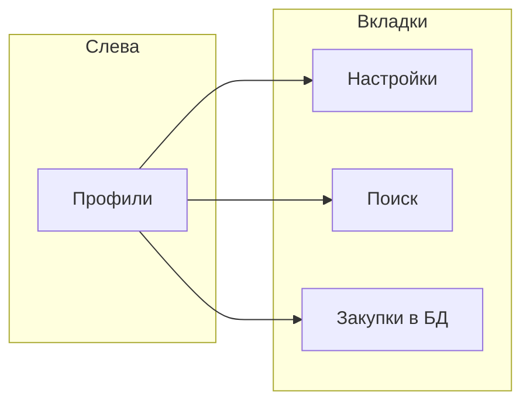

# Руководство пользователя — поиск закупок ЕИС

## Что это за система

Веб-приложение помогает **настроить поиск**, **загрузить сведения из ЕИС** (44-ФЗ и 223-ФЗ) и **хранить закупки в базе**. Дальше можно смотреть результаты прогона и общий список сохранённых закупок без повторного обращения к ЕИС.

Состав:

| Часть | Назначение |
|-------|------------|
| **UI** | Экран в браузере: профили, поиск, закупки |
| **search** | Запросы в ЕИС, фильтр по ключевым словам, сохранение в базу |
| **storage** | Профили, закупки, результаты прогонов в PostgreSQL |

Из ЕИС сохраняются **извещения** и **контракты**. Протоколы закупок не загружаются.

## Запуск (Docker Compose)

```bash
cp .env.example .env
# Задайте POSTGRES_PASSWORD и при необходимости EIS_* для реального поиска

docker compose up --build -d
```

Откройте UI: **http://localhost:8080** (порт задаётся переменной `UI_PORT`).

Проверка:

```bash
curl -s http://localhost:8080/healthz
```

Подробнее о переменных окружения и образах — в [README](../README.md).

## Безопасность v1

- **Trust network:** API **без логина и пароля**. Разворачивайте только во внутренней или доверенной сети.
- Снаружи по умолчанию доступен **только UI**. Сервисы storage и search — во внутренней сети compose.
- Доступ к ЕИС (логин, пароль, сертификаты) задаётся **только в `.env`**, не в профилях и не в git.

## Экран приложения



- **Профили** — список сохранённых настроек. Кнопка **Создать** — новый профиль. Имя в списке — выбор профиля. Значок **✎** — редактирование на вкладке **Настройки**.
- **Настройки** — форма выбранного профиля.
- **Поиск** — запуск прогона и результаты текущего прогона.
- **Закупки в БД** — все сохранённые закупки, независимо от ЕИС.

Кнопка **Справка** в шапке открывает краткую подсказку по тем же разделам.

## Профили поиска

1. Нажмите **Создать** или выберите профиль слева.
2. Заполните форму на **Настройки**:
   - **Название профиля** — уникальное имя.
   - **Закон** — `44-ФЗ`, `223-ФЗ` или **44 и 223** (общий лимит на оба канала).
   - **Ключевые слова** — по одному в строке. В закупку попадает текст, где **все** слова есть в названии или описании (логика AND).
   - **Лимит сохранённых закупок** — сколько записей максимум сохранить за один прогон.
3. Блок **Параметры ЕИС (44-ФЗ)** — регион (КЛАДР), типы документов, период размещения. Показывается для 44 и для «44 и 223».
4. Блок **Параметры ЕИС (223-ФЗ)** — типы сущностей, регион, период. Показывается для 223 и для «44 и 223».
5. **Сохранить** — записать профиль. **Удалить** — удалить выбранный профиль (с подтверждением).

Секреты ЕИС в профиль не вносятся — только параметры запроса.

## Запуск поиска

1. Выберите профиль слева.
2. Откройте вкладку **Поиск**.
3. Нажмите **Поиск**.

Что произойдёт:

- Статус: «ожидание», «идёт поиск», «завершён» или «ошибка».
- Строка **Загружено X / лимит Y** — сколько закупок уже сохранено в этом прогоне.
- Пока прогон идёт, кнопка **Поиск** временно недоступна.

Поиск выполняется в фоне; страницу можно не закрывать — данные подтягиваются автоматически.

## Результаты блоками

Список под кнопкой **Поиск** — закупки **текущего прогона**.

- Сначала показывается **до 10** карточек.
- **Загрузить ещё 10** — следующая порция (пока есть данные).
- В карточке: название, номер, закон, дата, заказчик.

Тот же прогон можно смотреть через API (см. [docs/api.md](./api.md)).

## Закупки в БД

Вкладка **Закупки в БД** — все закупки, уже лежащие в базе. ЕИС для этого списка **не нужна**.

1. При необходимости выберите **Все законы**, **44-ФЗ** или **223-ФЗ**.
2. Введите текст в **Поиск по названию** и нажмите **Обновить**.
3. Клик по карточке слева открывает **подробности** справа: номер, закон, тип (извещение или контракт), заказчик, ИНН, описание, ссылки на файлы.
4. **Загрузить ещё** — следующая страница списка.

Если одна и та же закупка приходит из ЕИС повторно, в базе остаётся версия с **более новой датой** документа; старая не перезаписывает новую.

## Ошибка «ЕИС недоступна»

Если ЕИС не отвечает или недоступна по сети:

- Прогон получает статус **ошибка** с текстом **ЕИС недоступна** (часто с краткой причиной после двоеточия).
- На вкладке **Поиск** показывается баннер **ЕИС недоступна**.
- Внизу вкладки — блок **Журнал сервиса поиска** (кнопка **Обновить лог**) или запрос `GET /api/search/logs`.
- В терминале: `docker compose logs search --tail=100` (также `storage`, `ui`).
- Закупки, успевшие сохраниться до сбоя, **остаются** в прогоне и в базе.
- Вкладка **Закупки в БД** работает как обычно.

Подставных данных из ЕИС система не создаёт.

## 44-ФЗ и 223-ФЗ

| Закон | Идентификатор в карточке | Что тянем из ЕИС |
|-------|--------------------------|------------------|
| 44-ФЗ | Реестровый номер | Извещения и контракты по параметрам 44 |
| 223-ФЗ | GUID или регистрационный номер | Извещения (`purchaseNotice`) и контракты |

Режим **44 и 223** запускает оба канала с **одним общим лимитом** на прогон.

## API для внешних клиентов

Краткое описание HTTP-методов — в [docs/api.md](./api.md). Через UI запросы идут на `/api/storage` и `/api/search` (прокси во внутренние сервисы).

## Локальный запуск без Docker

См. раздел в [README](../README.md): отдельно поднимаются storage, search, ui и PostgreSQL с переменными `DATABASE_URL`, `STORAGE_URL`, `SEARCH_URL`.
